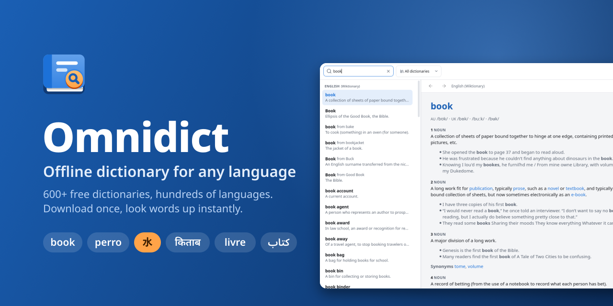
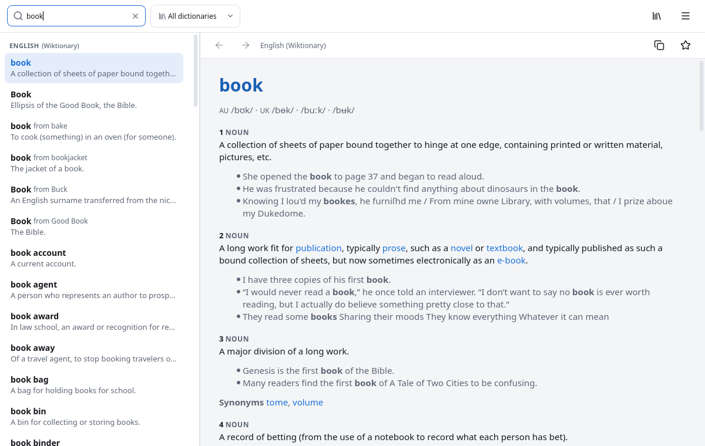
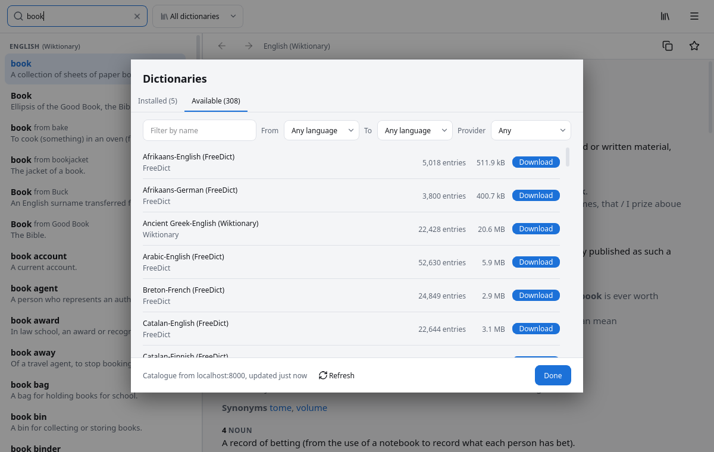
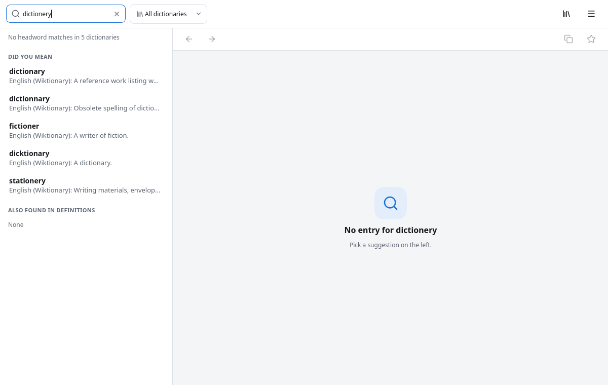
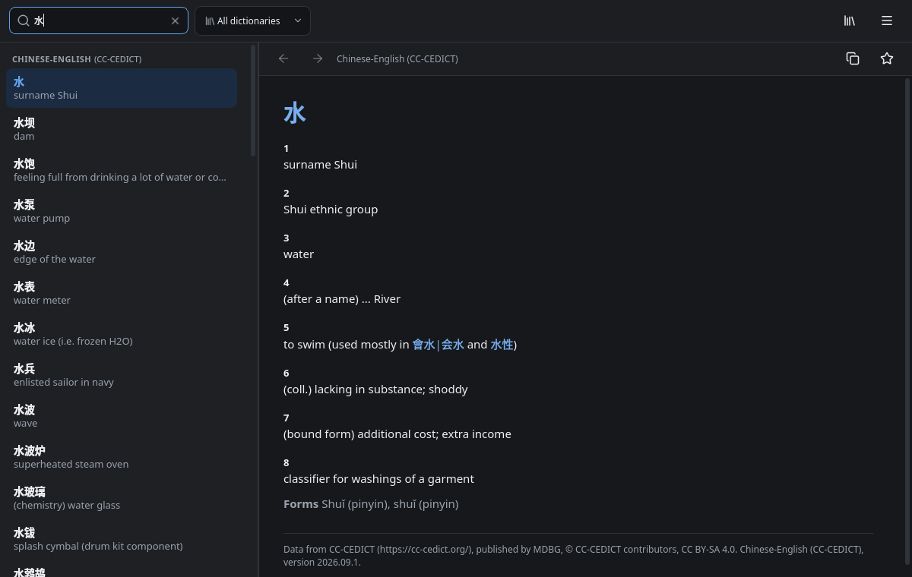

<p align="center">
  
</p>

<p align="center">
  <a href="https://flathub.org/apps/com.ktechpit.omnidict"></a>
  <a href="https://snapcraft.io/omnidict"></a>
</p>

<p align="center">
  Or download the <a href="https://github.com/keshavbhatt/omnidict/releases/latest">AppImage</a> from the latest release.
</p>

# Omnidict

Omnidict is a fast offline dictionary for the Linux desktop. Choose from more than six hundred
free dictionaries in hundreds of languages, download the ones you need once, and look words up
instantly, without an internet connection.

## Screenshots

<table>
  <tr>
    <td width="50%"><br><sub>Results as you type, grouped by dictionary</sub></td>
    <td width="50%"><br><sub>More than six hundred dictionaries to choose from</sub></td>
  </tr>
  <tr>
    <td width="50%"><br><sub>"Did you mean" suggestions for misspelled words</sub></td>
    <td width="50%"><br><sub>Any script, in light and dark themes</sub></td>
  </tr>
</table>

## Features

- **A dictionary for every language**: English Wiktionary and English WordNet (with synonyms
  and antonyms), Wiktionary for over three hundred languages explained in English, hundreds of
  bilingual FreeDict dictionaries, JMdict (Japanese), CC-CEDICT (Chinese) and Kengdic (Korean).
- **Fast lookup**: results as you type, accents optional, inflected forms find their entry
  (_ran_ finds _run_), wildcards (`?` and `*`) and full text search inside definitions.
- **"Did you mean" suggestions** for misspelled words, in every script.
- **Quick lookup**: select a word in any app and press a shortcut to see its meaning in a small
  window.
- **Favourites and recent lookups**, links between entries with Back and Forward.
- **Light and dark themes** that follow the desktop, adjustable text size, keyboard shortcuts
  for everything.
- **Private**: no tracking; the only network use is downloading dictionaries.

Bugs and requests: [GitHub issues](https://github.com/keshavbhatt/omnidict/issues).

## Development

A Qt 6.11 / C++20 client browses a catalogue of dictionaries and looks up words in one
consistent, offline SQLite bundle format (`.odict`) per dictionary; a Python data pipeline
(`omnipipe`) converts open dictionary sources into that format. See `DOCS/ROADMAP.md` for the
milestone plan and `DOCS/FEATURES.md` for the scope contract.

### Layout

```
app/         Qt 6.11 / C++20 client (CMake root is app/, see DECISIONS.md ADR-010)
pipeline/    Python 3.12 data pipeline, package omnipipe
tests/       fixtures and vectors shared by pipeline and app tests
scripts/     dev-build.sh, dev-run.sh, snap-runtime-env.sh
DOCS/        the project plan, coding standards, decisions, progress log
```

### Prerequisites

- `kde-qt6-core24-sdk` and `kf6-core24` snaps (Qt 6.11 build SDK and matching runtime):
  `sudo snap install kde-qt6-core24-sdk kf6-core24`
- CMake and Ninja
- `uv` for the Python pipeline

### Quick start

```sh
make fixture   # builds pipeline/out/sample-en/dict.sqlite from tests/fixtures/sample-en.jsonl
make test      # pipeline tests, the fixture, the app build, and ctest
make lint      # ruff, mypy, clang-format, clang-tidy, shellcheck, reuse
scripts/dev-build.sh --tests
scripts/dev-run.sh -- --lookup pipeline/out/sample-en/dict.sqlite perhaps
```

Real dictionaries from Wiktionary (run in `pipeline/`):

```sh
make build DICT=wikt-hi-en && make package DICT=wikt-hi-en
make catalog && make serve        # catalog.json and bundles on http://localhost:8000
```

### Documentation

Everything about the project lives under `DOCS/`; start with `DOCS/README.md` for the index
and workflow, and `DOCS/PLAN.md` for the architecture and canonical schema.

Licence: see `LICENSING.md`.
